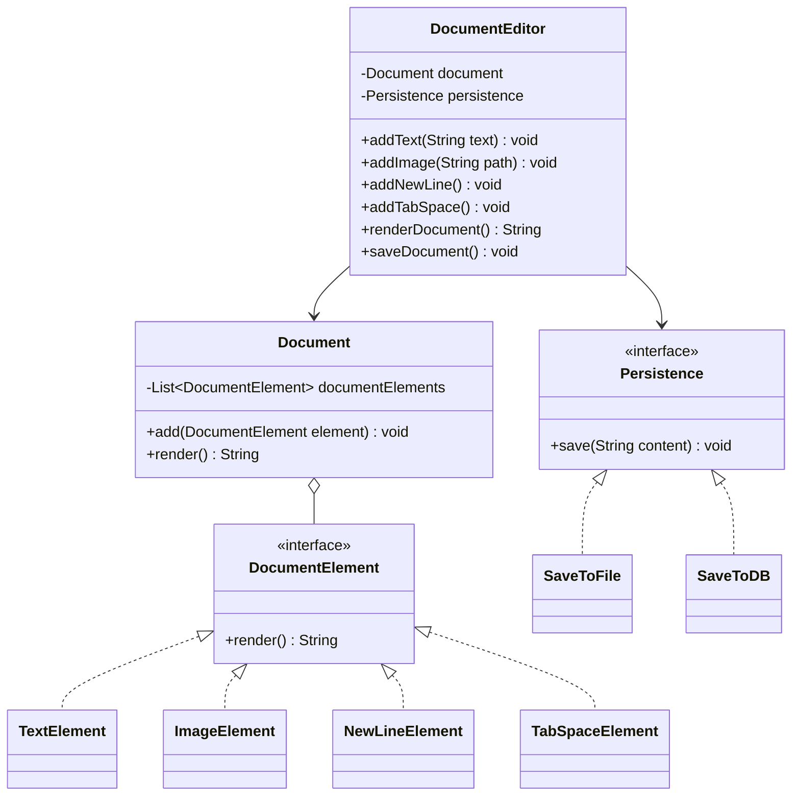

# Google Docs – Low-Level Design (LLD)

A Java-based implementation of a simplified Google Docs application, designed to demonstrate **Object-Oriented Programming (OOP)** principles, clean code, and software design patterns.

## 📌 Overview

This project models the core document editing functionality of a Google Docs–like application. It allows users to create documents, add different types of content, render the document, and save it through interchangeable persistence strategies.
The project focuses on building a modular, extensible, and maintainable design using Java.

## ✨ Features

- **Document Creation:** Create and manage document content.
- **Text Editing:** Add text to a document.
- **Image Insertion:** Add image references using file paths.
- **Formatting Elements:** Support newline and tab-space elements.
- **Document Rendering:** Combine all document elements into a single string.
- **Flexible Persistence:** Switch between file-based and database-based saving strategies.

> Note: Persistence currently uses console output to demonstrate the design. Actual file writing and database integration are not implemented yet.

## 🛠️ Tech Stack

- **Language:** Java
- **Core Concepts:** Object-Oriented Programming, Interfaces, Polymorphism, Composition, Dependency Injection
- **Design Patterns:** Strategy Design Pattern
- **Data Structures:** ArrayList, List, StringBuilder

## 🏗️ Design and Architecture

The application is divided into the following components:

| Component | Responsibility |
|---|---|
| `DocumentElement` | Defines the common rendering interface. |
| `TextElement` | Represents text content. |
| `ImageElement` | Represents an image reference. |
| `NewLineElement` | Represents a newline. |
| `TabSpaceElement` | Represents a tab space. |
| `Document` | Stores and renders document elements. |
| `Persistence` | Defines the persistence strategy interface. |
| `SaveToFile` | Demonstrates file-system persistence. |
| `SaveToDB` | Demonstrates database persistence. |
| `DocumentEditor` | Provides document editing, rendering, and saving operations. |

### Class Diagram



## 🎯 Design Patterns and Principles

### 1. Strategy Design Pattern

The `Persistence` interface defines a common contract for saving document content. `SaveToFile` and `SaveToDB` provide different implementations.

The persistence strategy can be changed without modifying the `DocumentEditor` class.

```java
Persistence persistence = new SaveToFile();

// Or switch to:
Persistence persistence = new SaveToDB();
```

### 2. Polymorphism

All document elements implement `DocumentElement`. The `Document` class renders each element through the common `render()` method without needing to know its concrete type.

### 3. Dependency Injection

`DocumentEditor` receives its `Document` and `Persistence` dependencies through its constructor, making the design flexible and easier to test.

### 4. Single Responsibility

Document elements handle their own rendering, `Document` manages content, and persistence implementations handle saving behavior.

## 📂 Project Structure

```text
GoogleDocsLLD/
├──Main.java
└── README.md
```

The example structure assumes all Java classes are currently defined in a single `Main.java` file. As the project grows, each class can be moved into its own Java file.

## 🚀 Getting Started

### Prerequisites

- Java Development Kit (JDK 8 or later)
- VS Code or IntelliJ IDEA
- Git (optional)

### Installation

**1. Clone the repository**

```bash
git clone <your-repository-url>
```

**2. Navigate to the project directory**

```bash
cd GoogleDocsLLD
```

**3. Compile the Java code**

```bash
javac Main.java
```

**4. Run the application**

```bash
java Main
```

## 💻 Example Usage

```java
Document document = new Document();
Persistence persistence = new SaveToFile();

DocumentEditor editor =
        new DocumentEditor(document, persistence);

editor.addText("Hello, Google Docs!");
editor.addNewLine();
editor.addText("This is my LLD project.");

System.out.println(editor.renderDocument());
editor.saveDocument();
```


## 📚 Learning Objectives

This project is intended to strengthen understanding of:

- OOP principles and SOLID design.
- Interfaces and polymorphism.
- Composition and dependency injection.
- Strategy Design Pattern.
- Extensible and maintainable low-level design.

## 👩‍💻 Author

**Ankita Khamkar**

GitHub: [AnkitaKhamkar25](https://github.com/AnkitaKhamkar25)

---
