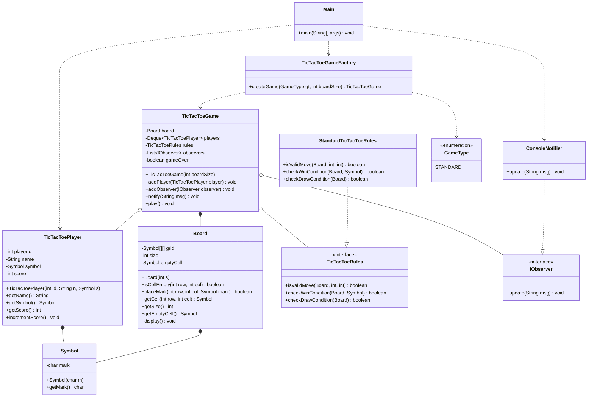

# Tic Tac Toe Game – Low-Level Design (LLD)

A console-based Tic Tac Toe game developed using **Java**, demonstrating Object-Oriented Programming principles and commonly used Design Patterns. The application supports a configurable N × N game board, two-player gameplay, turn management, win/draw detection, and an extensible notification system.

## Features

- **Custom Board Size:** Create a configurable N × N Tic Tac Toe board.
- **Two-Player Gameplay:** Supports two players with customizable names and symbols.
- **Turn Management:** Uses Java `Deque` to manage player turns.
- **Move Validation:** Prevents players from placing marks outside the board or on occupied cells.
- **Win Detection:** Checks rows, columns, main diagonal, and anti-diagonal.
- **Draw Detection:** Identifies when all cells are occupied without a winner.
- **Score Management:** Maintains player scores when they win.
- **Notification System:** Notifies observers about game events.
- **Extensible Architecture:** Supports different game rule implementations and notification services.

## Technologies Used

- Java
- Object-Oriented Programming (OOP)
- Java Collections Framework
- Design Patterns
- UML Class Diagram

## Design Patterns Used

### 1. Strategy Pattern

- **Interface:** `TicTacToeRules`
- **Implementation:** `StandardTicTacToeRules`
- Encapsulates game rules such as move validation, win detection, and draw detection.
- Allows different rule implementations without modifying the main game logic.

### 2. Observer Pattern

- **Interface:** `IObserver`
- **Implementation:** `ConsoleNotifier`
- `TicTacToeGame` acts as the observable.
- Notifies registered observers about game events, including game start, player moves, winning, and draws.
- Allows additional notification implementations without changing the game logic.

### 3. Factory Pattern

- **Factory:** `TicTacToeGameFactory`
- **Enum:** `GameType`
- Centralizes game object creation.
- Makes it easier to introduce additional game types in the future.

## Class Responsibilities

| Class / Interface | Responsibility |
|---|---|
| `Symbol` | Represents a player's mark (X, O, etc.). |
| `Board` | Manages the grid, cell validation, and board display. |
| `TicTacToePlayer` | Stores player details, symbol, and score. |
| `TicTacToeRules` | Defines the game rule contract. |
| `StandardTicTacToeRules` | Implements standard win, draw, and move validation logic. |
| `IObserver` | Defines the notification contract. |
| `ConsoleNotifier` | Displays game notifications in the console. |
| `TicTacToeGame` | Manages game flow, player turns, and game state. |
| `GameType` | Defines supported game types. |
| `TicTacToeGameFactory` | Creates game instances. |
| `Main` | Entry point of the application. |

## UML Class Diagram

The following diagram illustrates the class relationships, responsibilities, and design patterns used in the project.



## Project Structure

```text
Tic_Tak_Toc/
│
└── Main.java
    ├── IObserver
    ├── ConsoleNotifier
    ├── Symbol
    ├── Board
    ├── TicTacToePlayer
    ├── TicTacToeRules
    ├── StandardTicTacToeRules
    ├── TicTacToeGame
    ├── GameType
    ├── TicTacToeGameFactory
    └── Main
```

## How to Run the Project

### Prerequisites

- Java JDK 8 or above.
- Java compiler (`javac`).
- Terminal or command prompt.

### Step 1: Clone the repository

```bash
git clone <your-repository-url>
```

### Step 2: Navigate to the project directory

```bash
cd LLD-Mini-Projects/Tic_Tak_Toc
```

### Step 3: Compile the Java program

```bash
javac Main.java
```

### Step 4: Run the application

```bash
java Main
```

## Sample Output

```text
=== TIC TAC TOE GAME ===
Enter board size (e.g., 3 for 3x3): 3

[Notification] Tic Tac Toe Game Started!

  0 1 2
0 - - -
1 - - -
2 - - -

Ankita (X) - Enter row and column: 0 0

[Notification] Ankita played (0,0)

  0 1 2
0 X - -
1 - - -
2 - - -

Komal (O) - Enter row and column: 1 0

[Notification] Komal played (1,0)

...
Ankita wins!

[Notification] Ankita wins!
```

*Note: The sample output is illustrative. Actual gameplay depends on user input.*


## Key OOP Concepts Demonstrated

- **Encapsulation:** Private fields with controlled access through methods.
- **Abstraction:** Interfaces such as `TicTacToeRules` and `IObserver`.
- **Polymorphism:** Different implementations of game rules and observers.
- **Composition:** Game owns a board and manages players and observers.
- **Loose Coupling:** Design patterns separate game logic from rule implementations and notification mechanisms.

---

**Author:** Ankita Khamkar

**Project Type:** Low-Level Design (LLD) – Java Mini Project