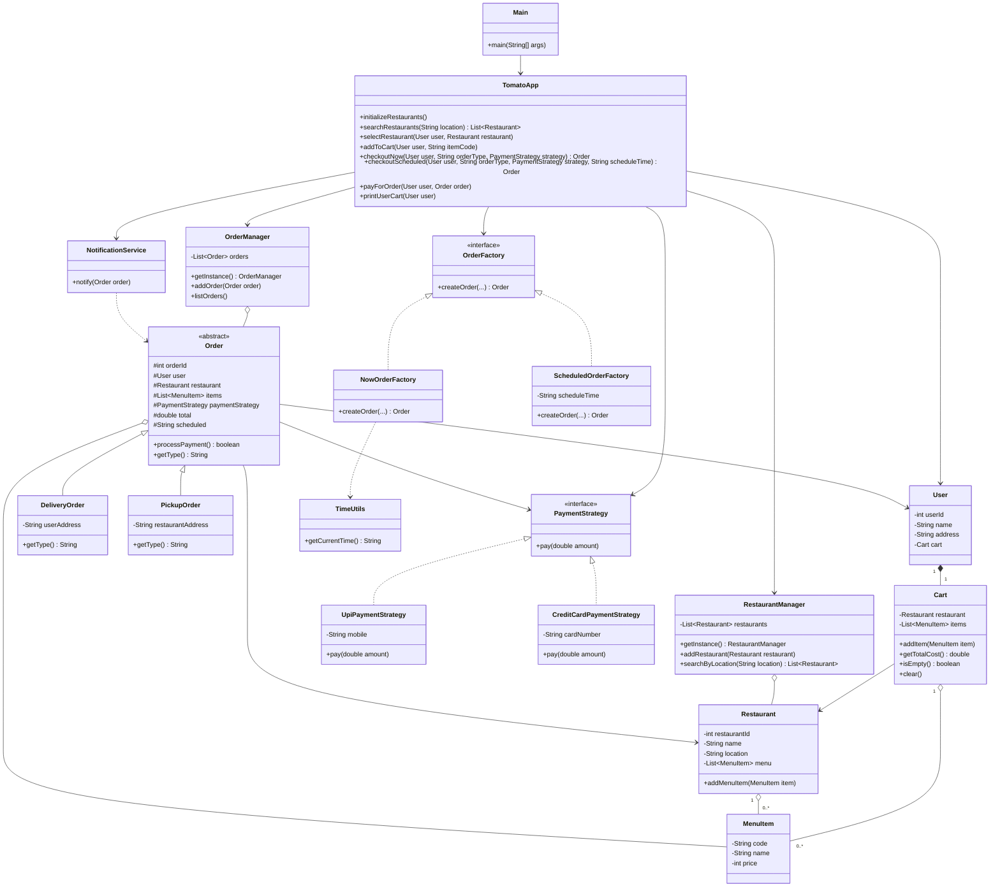

# 🍅 Tomato Food Delivery

A small Java console application that demonstrates the core flow of a food-delivery service: finding restaurants, choosing menu items, adding items to a cart, placing an immediate or scheduled order, processing a payment strategy, and printing an order notification.

This is an object-oriented learning project. It uses in-memory data and console output; it is not connected to a database, payment provider, or notification gateway.

## ✨ Features

- Search restaurants by location.
- Browse a restaurant's menu and add menu items to a user's cart.
- Create delivery or pickup orders.
- Create immediate or scheduled orders.
- Select UPI or credit-card payment behavior.
- Print order details after payment.
- Keep restaurants and orders in singleton manager classes for the lifetime of the process.

## 📁 Project Structure

```text
TomatoFoodDelivery/
├── Main.java
├── TomatoApp.java
├── Managers/
│   ├── OrderManager.java
│   └── RestaurantManager.java
├── Models/
│   ├── Cart.java
│   ├── DeliveryOrder.java
│   ├── MenuItem.java
│   ├── Order.java
│   ├── PickupOrder.java
│   ├── Restaurant.java
│   └── User.java
├── Service/
│   └── NotificationService.java
├── factories/
│   ├── NowOrderFactory.java
│   ├── OrderFactory.java
│   └── ScheduledOrderFactory.java
├── strategies/
│   ├── CreditCardPaymentStrategy.java
│   ├── PaymentStrategy.java
│   └── UpiPaymentStrategy.java
└── utils/
    └── TimeUtils.java
```

The Java package names follow the source folders: `Models`, `Managers`, `Service`, `factories`, `strategies`, and `utils`. `Main` and `TomatoApp` are in the default package.

## 📊 Class Diagram



## 🔄 Order Flow

1. `Main` creates `TomatoApp`; the app initializes sample restaurants and menu items.
2. The user searches for restaurants by location through `RestaurantManager`.
3. The user selects a restaurant and adds menu items to their cart.
4. `TomatoApp` checks out using either `NowOrderFactory` or `ScheduledOrderFactory`. Each factory creates a `DeliveryOrder` or `PickupOrder` based on the requested order type.
5. The order stores a `PaymentStrategy`, and `OrderManager` records it.
6. `payForOrder` processes payment. On success, the app prints the notification and clears the user's cart.

## 🧩 Design Patterns

- **Singleton:** `RestaurantManager` and `OrderManager` expose a shared instance through `getInstance()`.
- **Factory:** `OrderFactory` separates immediate and scheduled order construction from the app's checkout flow.
- **Strategy:** `PaymentStrategy` allows payment implementations such as UPI and credit card to be supplied to an order.

## ▶️ Run the Demo

**Requirements:** A JDK with `javac` and `java` available on `PATH` (Java 8 or later).

The demo searches for restaurants in Mumbai, adds two items from the sample menu to the cart, checks out a delivery order using UPI, and prints the payment and order notification details.

## 📝 Notes

- All sample restaurant, cart, and order data is held in memory and is lost when the application exits.
- Payment strategies currently demonstrate the flow by printing payment details; they do not contact a payment provider.
- `TomatoApp` seeds the sample restaurants when it is constructed. Since `RestaurantManager` is a singleton, constructing multiple app instances in one process adds the sample restaurants again.
